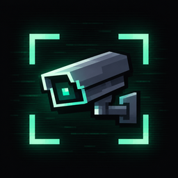

<p align="center">
  
</p>

<h1 align="center">HIKVision</h1>

<p align="center">
  Клиентский мод для Minecraft: камеры наблюдения и мониторы из обычных голов игроков.<br>
  Без серверной части — работает на любом сервере и в одиночной игре.
</p>

<p align="center">
  <b>Minecraft</b> 1.21.11 · <b>Fabric</b> · <b>Версия</b> 1.0.8 · <b>Только клиент</b>
</p>

---

## Содержание
- [Возможности](#возможности)
- [Установка](#установка)
- [Быстрый старт](#быстрый-старт)
- [Как называть головы](#как-называть-головы)
- [Использование](#использование)
  - [Монитор](#монитор)
  - [Просмотр камер](#просмотр-камер)
  - [Вкладка «Настройка»](#вкладка-настройка)
  - [Камеры на игроках](#камеры-на-игроках)
- [Дополнительные функции](#дополнительные-функции)
- [Темы оформления](#темы-оформления)
- [Настройки](#настройки)
- [Где хранятся данные](#где-хранятся-данные)
- [Ограничения](#ограничения)
- [Решение проблем](#решение-проблем)
- [Сборка из исходников](#сборка-из-исходников)
- [Лицензия и примечания](#лицензия-и-примечания)

---

## Возможности
- **Камеры и мониторы из голов игроков.** Достаточно переименовать голову в наковальне.
- **Камеры строго по названиям.** Монитор показывает ровно те головы `Camera`, чьи названия ему подходят: тег в названии камеры совпадает с тегом в названии монитора. Никаких групп и привязок — у любого игрока с модом, без передачи данных.
- **Просмотр «глазами» камеры:** осмотр на WASD (с ограничением угла), зум колесом или Q/E (запоминается для каждой камеры).
- **Камеры на игроках:** голова `Camera` на голове даёт вид глазами игрока, в руке — вид из руки с покачиванием при ходьбе.
- **Избранное и закладки 1–9**, автосмена камер, скриншоты с оформлением темы.
- **Детектор движения**, **ночное видение**, **радиус сигнала** со слабым сигналом и помехами.
- **12 тем оформления** с настоящими шейдерами (ч/б, 8-бит, терминал, подводная и др.), прозрачный фон.
- **Собственные звуки**, настройки в Mod Menu с категориями.

## Установка
**Требования:** Minecraft **1.21.11**, [Fabric Loader](https://fabricmc.net/use/installer/) ≥ 0.18, [Fabric API](https://modrinth.com/mod/fabric-api), Java 21.
[Mod Menu](https://modrinth.com/mod/modmenu) — по желанию (нужен для окна настроек).

1. Установите Fabric Loader для Minecraft 1.21.11.
2. Положите `hikvision-1.0.8.jar` и Fabric API в папку `mods`.
3. Запустите игру. Устанавливать что-либо на сервер **не нужно**.

## Быстрый старт
1. Возьмите две головы игроков (например, из креатива или командой `/give @s player_head`).
2. В **наковальне** назовите одну `Monitor`, другую — `Camera: дом 1`.
3. Поставьте голову `Camera: дом 1` в нужном месте — она смотрит туда, куда обращено её лицо.
4. Возьмите `Monitor` в руку и нажмите **ПКМ** — откроется интерфейс. Камера «дом 1» уже в списке.
5. Хотите, чтобы монитор показывал только камеры с тегом `дом`, назовите его `Monitor: дом`.

## Как называть головы
Названия задаются в наковальне (до 50 символов). **Регистр не важен.** Всё остальное мод определяет сам.

| Голова | Название | Значение |
|---|---|---|
| Камера | `Camera: lobby 2` | камера №2 с тегом `lobby` |
| Камера | `Camera: lobby` | камера №0 с тегом `lobby` |
| Камера | `Camera 3` | камера №3 без тега |
| Монитор | `Monitor: lobby` | показывает камеры с тегом `lobby` |
| Монитор | `Monitor: lobby, door` | показывает камеры с тегами `lobby` и `door` (теги — через запятую) |
| Монитор | `Monitor` | показывает **все** найденные камеры |

Правила:
- Слова `Camera` и `Monitor` должны стоять в начале названия и заканчиваться пробелом, двоеточием или концом строки (`Cameraman` камерой не считается).
- **Последнее число** в названии камеры — её номер. Всё между префиксом и номером — тег.
- Регистр тега не важен: `Lobby` и `lobby` — один тег.
- Номера с одним тегом лучше делать уникальными: камеры с одинаковым тегом и номером мод считает одной.
- Префиксы (`Camera`, `Monitor`) можно поменять в настройках или в `config/cameramonitor.json`.

> **Синхронизация между игроками происходит сама.** Если другой игрок с модом назовёт свой монитор `Monitor: lobby`, он увидит те же камеры `Camera: lobby N`. Список камер всегда совпадает с названиями голов в мире: переименовали или убрали голову — камера пропала из списка. Избранное и зум хранятся у каждого игрока отдельно.

## Использование

### Монитор
| Действие | Результат |
|---|---|
| **ПКМ** с `Monitor` в руке (в воздух) | открыть интерфейс |
| **ПКМ по блоку** с `Monitor` в руке | открыть интерфейс (если включено «Shift для установки Monitor») |
| **Shift + ПКМ по блоку** с `Monitor` в руке | поставить голову |
| **ПКМ** по установленному `Monitor` | открыть интерфейс |
| **Shift + ПКМ** по установленному `Monitor` | обычное взаимодействие с блоком |

Монитор распознаётся по названию установленной головы, поэтому после перезахода ничего заново привязывать не нужно.

### Просмотр камер
Режим «Просмотр» показывает картинку с выбранной камеры на весь экран. Сверху — одна компактная строка, внизу картинки — панель управления.

**Верхняя строка:** `⚙` — режим «Настройка» · `◐` — тема (Shift — предыдущая) · `★` — показывать только избранные · название монитора · `✕` — закрыть.

**Панель снизу:** `◀ ▶` — предыдущая/следующая камера · `★` — в избранное · `↻` — автосмена · `◉` — скриншот · `⇆` — автоповорот камеры. Между стрелками — название камеры, номер в списке и зум.

**Клавиши и мышь:**

| Управление | Действие |
|---|---|
| **W A S D** | двигать изображение (угол ограничен настройкой «Угол осмотра»); положение запоминается для каждой камеры |
| **C** | вернуть взгляд камеры в центр |
| **Q / E** или **колесо мыши** | зум ×1–×8, сохраняется для каждой камеры |
| **← / →** | предыдущая / следующая камера |
| **1 – 9** | перейти к избранной камере с этим номером |
| **T** / **Enter** | открыть поле чата; **/** — сразу команда |
| **Esc** | закрыть чат, затем монитор |

Список камер — плоский, отсортирован по тегу и номеру; никаких групп и вкладок нет. Интерфейс закрывается автоматически, если вы получили урон. Пока он открыт, персонаж не двигается.

### Вкладка «Настройка»
Откройте её кнопкой `⚙`. Здесь список **всех найденных камер, подходящих монитору**, и помощник для названий.

**Кнопки сверху:**
- **Обновить** — заново найти головы в загруженных чанках.
- **Имя для камеры** — копирует название следующей камеры (`Camera: тег N`) в буфер обмена; вставьте его в наковальне.
- **Имя для монитора** — копирует название для головы `Monitor`.

**Строки списка.** Цветная точка: 🟢 найдена · 🔴 не найдена · 🟠 было движение; справа указан источник (`BLOCK`, `HEAD`, `HAND`). Кнопки: `★` — избранное · `⎘` — скопировать название камеры · `▶` — смотреть эту камеру.

**Превью инвентаря.** Справа ваш инвентарь, но только с головами `Camera`. Клик по слоту копирует название следующей камеры (каждый клик увеличивает номер) — удобно подписывать несколько голов подряд.

> Мод работает только на клиенте и не может переименовывать предметы. Название вы задаёте в наковальне; мод лишь готовит текст и кладёт его в буфер обмена.

### Камеры на игроках
Голова `Camera`, надетая на голову или взятая в руку, тоже считается камерой. Это работает и для других игроков, мобов и стоек для брони, если они в зоне загрузки.

| Где голова | Что показывает |
|---|---|
| На голове | вид глазами носителя: игра сама ставит камеру в его глаза и ведёт её за его взглядом, а его голова и тело не рисуются |
| В основной или второй руке | вид из руки: положение считается из тех же величин, что двигают руку в ванильной анимации (шаг, «дыхание», приседание, угол тела), поэтому не зависит от текстур и ресурспака; сила покачивания настраивается |
| Снята / убрана | «Нет сигнала» |

Если голов несколько, приоритет у шлема, затем основная рука, затем вторая.

## Дополнительные функции
- **Чат в окне камеры.** Поверх картинки показываются последние сообщения чата (в стиле текущей темы: цвета, рамка, в Terminal 1999 — моноширинный шрифт), а `✉` в верхней строке, клавиша **T** или **Enter** открывает поле ввода. **Enter** отправляет сообщение (текст, начинающийся с `/`, уходит как команда), **Esc** закрывает поле. Пока вы печатаете, клавиши камеры (WASD, Q/E, цифры) не срабатывают. Количество строк и время показа настраиваются, чат можно отключить. На скриншоты чат не попадает.
- **Автоповорот `⇆`.** Камера сама поворачивается вправо до предела, стоит 3 секунды, поворачивается влево до предела, стоит 3 секунды — и так по кругу. Скорость, пауза и размах настраиваются во вкладке «Автоповорот» (размах не больше «Угла осмотра»). Любая из клавиш W/A/S/D возвращает ручное управление. Во время автоповорота промежуточные углы как «запомненный взгляд» не сохраняются.
- **Закладки 1–9.** Избранные камеры нумеруются по порядку. Клавиши 1–9 в режиме просмотра переключают на них; номер виден у звёздочки в панели.
- **Автосмена `↻`.** Переключает камеры по кругу через заданный интервал (3 / 5 / 10 / 20 / 30 с).
- **Скриншот `◉`.** Кадр без кнопок, с оформлением темы и меткой времени. Файлы: папка `screenshots` игры, имя вида `cam_<название камеры>_<дата>.png`.
- **Детектор движения.** Если рядом с камерой (по умолчанию 8 блоков) появился игрок, на картинке мигает надпись `MOTION`, точка камеры в списке «Настройки» становится жёлтой и звучит тихий сигнал. Пока монитор в руке или открыт интерфейс, срабатывание показывается также сообщением над хотбаром. Можно включить реакцию и на мобов.
- **Ночное видение.** Если в точке камеры темно, включается усиление света в зелёной гамме и надпись `NIGHT VISION`. Требует шейдер.
- **Радиус сигнала.** Дальше заданной дистанции (по умолчанию 128 блоков) картинка начинает искажаться: шейдер сдвигает и рвёт строки, расслаивает цвета, размывает и добавляет зерно (6 ступеней по расстоянию), камера дрожит и «дышит», по экрану плывут полосы помех и мигает `WEAK SIGNAL`. В 1,5 раза дальше сигнал пропадает. Можно отключить.
- **«Нет сигнала».** Заставка с шумом и тихим звуком, если камера не найдена, снята или далеко. Если выбранную камеру убрали или переименовали, она остаётся на экране с надписью «нет сигнала», пока вы не переключитесь, и затем пропадает из списка.
- **Дождь и пыль на объективе.** У блочных камер на стекле видна пыль (степень настраивается), а когда над камерой идёт дождь, по объективу стекают капли.
- **Звук с камеры.** Пока вы смотрите камеру, «ухо» игры находится в точке камеры, и громкость звуков считается от неё. Но сервер отправляет игроку только звуки, которые происходят возле него самого (около 16 блоков), поэтому далеко от себя вы услышите лишь то, что сервер сочтёт слышимым вам.

## Темы оформления
Тема переключается кнопкой `◐` в мониторе (Shift — назад) или в настройках. Фон интерфейса прозрачный (степень настраивается).

| Тема | Стиль |
|---|---|
| **Classic Surveillance** | зелёный монохром, строчная развёртка, пиксельные рамки |
| **Night Shift** | почти чёрный интерфейс, тёмно-красные индикаторы, аварийная подсветка |
| **Analog Tape** | янтарь и коричневый, шум плёнки, счётчик ленты |
| **Cyber Surveillance** | графит и бирюза, сетка, свечение |
| **Tactical** | оливковый, прицел, координаты, технические метки |
| **VHS Horror** | чёрно-белое, сильные помехи, нестабильное время |
| **Ghost Signal** | полупрозрачные панели, слабое зелёное свечение |
| **Neon Noir** | пурпур и бирюза, неон, бегущая линия |
| **Pixel 8-bit** | крупные пиксели, ограниченная палитра, игровой HUD |
| **Deep Ocean** | глубокий тёмно-синий, холодное голубое свечение, подводное наблюдение: лучи света, «морской снег», пузыри, глубиномер, редкие помехи |
| **Liminal** | пустые помещения и бесконечные коридоры: выцветшие цвета, слабый шум и размытие, мягкие размытые края, гул ламп, «OBSERVED» |
| **Terminal 1999** | старый терминал: зелёный моноширинный текст, мигающий курсор, журнал сигнала («> SIGNAL ... OK»), пиксельные панели и технические надписи |

Эффекты изображения построены на пост-шейдерах. Если шейдер у вас не работает, отключите его в настройках — останутся лёгкие наложения.

## Обновления
При запуске мод один раз спрашивает GitHub о последнем релизе (https://github.com/dev040524/hikvision/releases). Если вышла версия новее установленной, при входе в мир в чат приходит сообщение со ссылкой; статус версии виден и в окне настроек (кнопка «Ссылка на релизы» копирует адрес). Проверка идёт в фоне, без сети она молча пропускается; отключается в разделе «Общее».

## Настройки
Окно настроек открывается из **Mod Menu** (HIKVision → Настройки). Слева — категории, справа — параметры, при наведении показывается описание. Кнопка «Сбросить раздел» возвращает значения по умолчанию только для выбранной категории.

| Категория | Параметры |
|---|---|
| **Оформление** | тема · непрозрачность фона · размер экрана · шейдер · дождь/пыль на объективе · линии развёртки · координаты на картинке |
| **Автоповорот** | скорость (°/с) · пауза на краях · размах |
| **Просмотр** | чат в окне камеры (вкл/выкл, строк, время показа) · звуки · ночное видение · запоминать взгляд · открывать последнюю камеру · интервал автосмены · угол осмотра |
| **Камеры** | радиус сигнала · Shift для установки Monitor · камеры на голове/в руках · названия `Camera` и `Monitor` |
| **Общее** | проверка обновлений |
| **Детектор движения** | вкл/выкл · радиус · реагировать на мобов |

Файл настроек: `config/cameramonitor.json`.

## Где хранятся данные
- Настройки мода: `config/cameramonitor.json`.
- Ваши пометки (избранное, зум, последняя камера): `config/cameramonitor/<мир или сервер>.json`. Состав списка камер там **не хранится** — он определяется названиями голов в мире.
- Скриншоты: `screenshots/` в папке игры.

## Ограничения
- Камера работает только в **загруженных чанках** — в пределах дальности прорисовки сервера. Дальше — «Нет сигнала».
- Мод клиентский, поэтому не может переименовывать предметы. Названия вы задаёте в наковальне; мод лишь готовит текст.
- Название установленной головы должно передаваться клиенту (в ванили оно передаётся). Если сервер скрывает его, камеры и мониторы не будут найдены.
- Названия до 50 символов — этого хватает на 5–6 тегов в названии монитора.
- Камеры с одинаковым тегом и номером считаются одной.
- Совместимость с модами, меняющими рендер и пост-эффекты (в том числе шейдерпаки Iris), не проверялась.

## Решение проблем
| Проблема | Что проверить |
|---|---|
| Камера не появляется в списке | точное название (`Camera: тег N`); голова — **голова игрока**; чанк загружен; тег камеры совпадает с тегом монитора; нажмите «Обновить» в «Настройке» |
| Монитор показывает не те камеры | теги монитора (`Monitor: тег1, тег2`); без тега он показывает все камеры |
| ПКМ по монитору ставит голову, а не открывает интерфейс | нет Shift; проверьте, что название `Monitor...` написано верно |
| Нет картинки при шейдере / странные цвета | отключите «Шейдер» в разделе «Оформление» |
| Нет звука | включите «Звуки»; проверьте громкость категории «Основная громкость» |
| Нет окна настроек | установите Mod Menu |

Если что-то не работает, откройте *Issue* и приложите `logs/latest.log` и версии Minecraft/Fabric/мода.

## Сборка из исходников
Нужны JDK 21 и Gradle.

```bash
gradle wrapper --gradle-version 9.2.1   # один раз
./gradlew build
```

Готовый файл: `build/libs/hikvision-1.0.8.jar`. Версии зависимостей (Yarn, Loader, Fabric API, Mod Menu) указаны в `gradle.properties`; актуальные значения — на [fabricmc.net/develop](https://fabricmc.net/develop/).

Структура:
- `src/main/java/com/cameramonitor` — логика (поиск камер, сигнал, перехват взаимодействий, звуки, конфиг);
- `src/main/java/com/cameramonitor/ui` — интерфейс, темы, эффекты изображения;
- `src/main/java/com/cameramonitor/mixin` — подмена камеры рендера, зум и применение шейдера;
- `src/main/resources/assets/cameramonitor` — переводы, звуки, шейдеры и пост-эффекты тем.

## Лицензия и примечания
- Код распространяется по лицензии MIT (файл `LICENSE`).
- Звуки `switch`, `open`, `alert`, `nosignal` созданы из предоставленных автором файлов; остальные сгенерированы программно. Если вы публикуете мод, убедитесь, что у исходных файлов есть лицензия, разрешающая распространение.
- Название «HIKVision» используется как условное. Мод не связан с компанией Hikvision и не одобрен ею.
